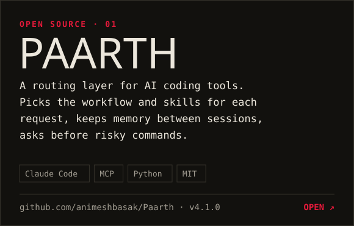
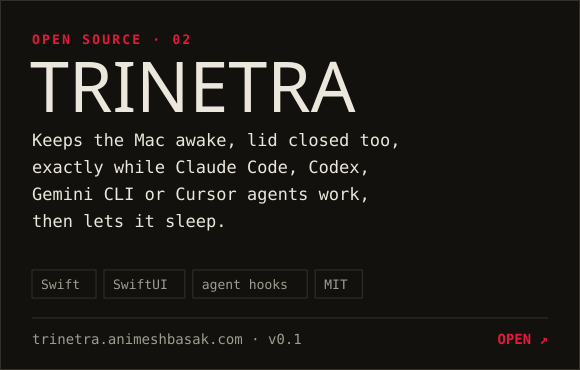

<!--
  Animesh Basak · GitHub profile
  Lead Frontend Engineer · BFF · AI-native delivery
  Updated: November 2026
-->

  <picture>
    <source media="(prefers-color-scheme: dark)" srcset="assets/hero-dark.svg" />
    <source media="(prefers-color-scheme: light)" srcset="assets/hero-light.svg" />
    
  </picture>

  
  
  

  
  
  

## About

Lead Frontend Engineer with 8 years on high-traffic consumer products: hotels booking at MakeMyTrip, merchant payments at Paytm, and the Airtel Thanks app (150M+ MAU), where I lead a squad of 5–7 engineers.

I own journeys end to end: React and TypeScript front ends on mobile web, desktop and React Native, the Backend-for-Frontend (BFF) layer behind them, and Spring Boot services where needed. I ship with AI: MCP-integrated delivery workflows at work, and open-source developer tools outside it.

## Open source

<a href="https://github.com/animeshbasak/Paarth">
  <picture>
    <source media="(prefers-color-scheme: dark)" srcset="assets/card-paarth-dark.svg" />
    <source media="(prefers-color-scheme: light)" srcset="assets/card-paarth-light.svg" />
    
  </picture>
</a>

<a href="https://trinetra.animeshbasak.com/">
  <picture>
    <source media="(prefers-color-scheme: dark)" srcset="assets/card-trinetra-dark.svg" />
    <source media="(prefers-color-scheme: light)" srcset="assets/card-trinetra-light.svg" />
    
  </picture>
</a>

Also building, not public yet: **Lakshya Hub** (résumé to tracked application, personal beta) and **Glass** (a Fire TV home screen with a Claude assistant, in daily use). Demos at [animeshbasak.com](https://animeshbasak.com/).

## Experience

**Airtel Digital** · Lead Engineer · 2025 → 
Lead 5–7 engineers on Airtel Thanks journeys (150M+ MAU). Gen4 Self-KYC revamp with one unified BFF family. HLD/LLD and final production review.

**MakeMyTrip** · Senior Software Engineer II, Frontend · 2024 → 2025 
Hotels booking PWA and desktop web: Lighthouse 6 → 8–9. Fixed a defect behind 1,000+ Sentry errors in 48 hours.

**Paytm** · Software Engineer · 2021 → 2024 
Legacy-to-React migration for journeys serving 3M+ merchants. Soundbox checkout.

**Sparklin Innovations** · Frontend Developer · 2021 
Frontend lead for Nirvana, the revamp of ICICI Bank's internet banking, in Angular 8. Built several modules from scratch.

**Infosys** · Systems Engineer · 2018 → 2021 
ANZ Bank's FINACLE: built React and Angular UI modules and automated their UI and API tests with WebdriverIO and Postman.

## Stack

**Frontend** · React · TypeScript · Next.js · React Native · Redux · Zustand · design systems 
**Architecture** · Micro-frontends · Module Federation · SSR · Core Web Vitals · HLD/LLD 
**BFF/Backend** · BFF orchestration · REST · Spring Boot · Node.js · PostgreSQL 
**AI** · Claude Code · Cursor · MCP · LLM applications · agent hooks · Ollama 
**Delivery** · Vitest · Jest · RTL · Sentry · GrowthBook · Jenkins · GitHub Actions

New Delhi, India · <a href="https://animeshbasak.com/">animeshbasak.com</a> · animeshsbasak@gmail.com

